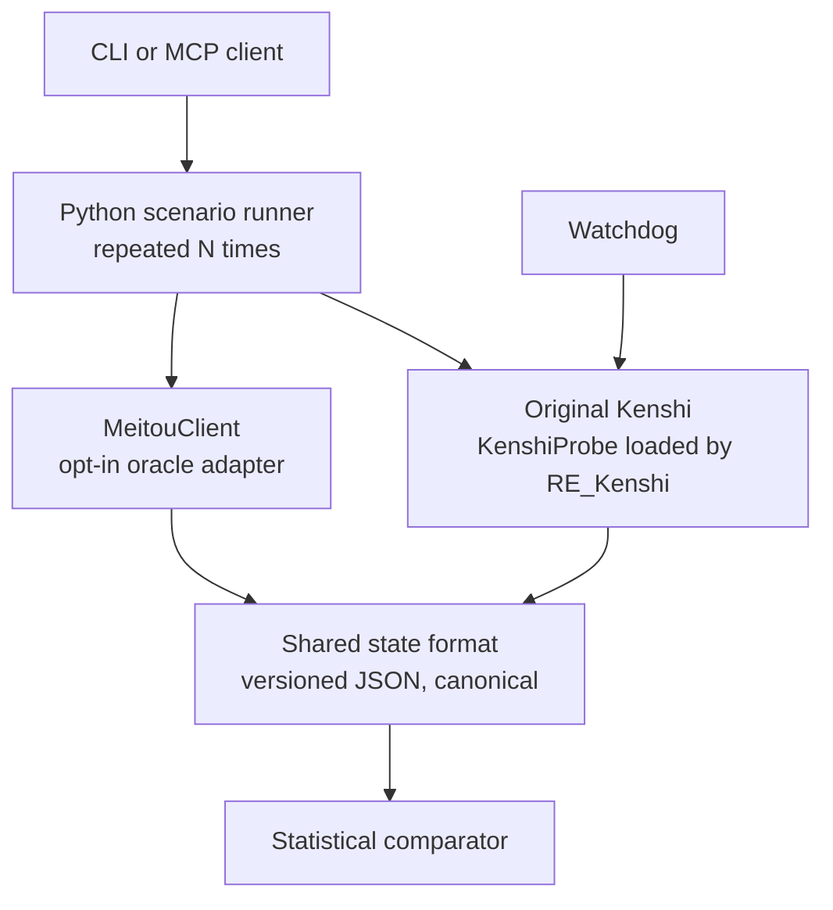

# KenshiOracle

An automated state-capture oracle for Kenshi. It reloads local saves, repeats scripted experiments in the original game and captures a shared, versioned state format. The procedure is repeatable; the game's results are not deterministic.

It works with the original Kenshi through RE_Kenshi and KenshiLib, to investigate mods, plugins or bugs. It also compares repeated observations with [MeitouClient](https://github.com/VlcekM/MeitouClient), the open-source reimplementation of the Kenshi engine. RE_Kenshi changes some game behaviour, so this is not an unmodified vanilla baseline.

> **Status:** phase 2 implemented; current probe release **0.10.0**. The original reference controller, state 0.2, opt-in MeitouClient adapter and comparator are available. Quiet town was compared with **five repetitions per engine**; battle/travel each have one Meitou validation. The [validation](docs/phase2-validation.md) records exact campaign binaries, remaining coverage gaps and test limitations.
>
> KenshiOracle is an independent project. It is not affiliated with or endorsed by Lo-Fi Games or the MeitouClient team. Kenshi is a trademark of Lo-Fi Games. You need your own copy of Kenshi; no game files are distributed.

The [phase 2 validation](docs/phase2-validation.md) records the real five-versus-five quiet-town comparison, its limits and the tests that remain unsuccessful or unverified.

Use the [documentation index](docs/README.md) for oracle setup and the separate research archive.

## Why

MeitouClient aims to run the original content and saves. KenshiOracle prepares automated behaviour checks: run the same scenario on both engines, capture states and compare the repeated observations. Phase 1 supplies the original-game captures and reports which fields vary between its repetitions.

The original game in the validated RE_Kenshi environment is **not deterministic**. In three repetitions of one small battle on probe 0.9.3, the final checkpoint has 32,435 variable fields and 253, 323 and 284 loaded characters. A variable field may change value or be absent in a repetition. The statistical comparator separates observed variation from fields stable in the original but different elsewhere. See the [phase 1 delivery evidence](docs/oracle-phase1-delivery.md).

## Using it without MeitouClient

The probe, the Python runner, the MCP server and the watchdog work without MeitouClient. Scenario reports compare repetitions within one run. The [cross-engine comparator](docs/comparator.md) accepts certified original/Meitou campaigns and produces local reports and issue drafts; completed campaigns alone do not establish parity.

- **Investigate a mod.** Capture the same scenario with and without the mod, N times each, then inspect the state files for changes in populations, relations and character status. Automated comparison between those batches is future work.
- **Investigate an RE_Kenshi plugin** with the same capture workflow.
- **Investigate a bug.** Repeat a scenario and inspect whether its observable symptoms occur in the captured state; absence from a snapshot does not prove the bug never happened.
- **Let an AI agent play or observe Kenshi** through the MCP tools.
- **Extract game data** for analysis: factions, relations and populations over time.

Scenario reports record the scenario, save identity fingerprint and probe information. Each validated snapshot has a SHA-256. These identify the captured inputs and output; phase 1 does not record every RE_Kenshi setting or every part of the game environment.

## How it works



- **KenshiProbe** is a plugin loaded by [RE_Kenshi](https://github.com/BFrizzleFoShizzle/RE_Kenshi). It reads the game state through [KenshiLib](https://github.com/BFrizzleFoShizzle/KenshiLib) and listens on **`127.0.0.1:47800`** by default. Game commands are queued for the game's main thread; the network thread can serve the cached heartbeat. Transport is one UTF-8 JSON request and response per line. Full snapshots use files, keeping network responses bounded.
- **The MCP server** (Python) exposes the probe as tools for an agent, runs scenarios end to end and validates every snapshot against the schema.
- **The watchdog** launches and owns one Kenshi process, watches its heartbeat, archives available logs/dumps and restarts after an exit or freeze. Optional `startup_save` requests a load once per launch. It does not restore the scenario's camera or controls itself: after a restart, use `restore_scenario()` to reload the recovery save and verify the recorded controls. Interrupted experiments are not resumed.

## State format

The original [state schema 0.1](schema/state.schema.json) covers:

- the game clock, speed and pause state; `elapsed_seconds` is absolute world-calendar seconds (in-game hours × 3600), neither real elapsed time nor simulated time;
- loaded characters: opaque id, name, race, faction, squad, position, state (alive, unconscious, dead or unknown), health per body part, immediate task or order;
- squads: id, faction, members, leader;
- factions (id and name) and directional faction relations.

Snapshots are **canonical**: collection and object-key ordering and six-decimal number encoding follow fixed rules, so the same state produces the same bytes. Equality of native files, MCP copies and Python canonicalisation was verified for the synthetic cases and real captures listed in the [delivery report](docs/oracle-phase1-delivery.md). Unknown nullable values remain `null` rather than being replaced by zero.

When the public SDK proves a link to a character or squad in the source save, the probe exports its **saved HAND**. Otherwise it retains the current HAND; a missing link alone does not prove an NPC was generated. NPCs generated on activation were observed with changing identities. Phase 2 compares NPCs without proven saved identities in groups; town/region membership is not present in state 0.1. Field coverage and identity limits, with **Verified / Observed / Unknown** status, are in [`docs/state-coverage.md`](docs/state-coverage.md) and the [NPC identity audit](docs/npc-identities-phase1.md).

[State 0.2](schema/state-0.2.schema.json) adds seven nullable/provenance fields for identity origin, combat mode, squad template and town placement. Town identities remain unknown in both producers. Version 0.1 remains supported; see the [coverage and real-capture evidence](docs/state-coverage.md#extension-additive-02).

## Scenarios

A scenario describes an experiment: a starting save, a game speed, timed orders and checkpoints where a snapshot is taken. Each repetition reloads that save. Times are calendar seconds relative to the first paused state after loading; the report records the actual checkpoint times and any overshoot.

**Time units.** Scenario `at`, checkpoint times and `elapsed_seconds` are game **calendar** seconds (in-game hours × 3600) on both targets. MeitouClient defines one in-game hour as `1200/11` ≈ 109.1 simulated seconds (**Verified** in its code), so **1 simulated second ≈ 33 calendar seconds**: a checkpoint at 120 s is about 3.6 simulated seconds and one at 600 s about 18.2 simulated seconds. On the original, the same hour length is **Observed** only indirectly; a direct measurement of simulated time on both targets is pending (**Unknown**). Details: [time units](docs/protocol.md#time-units).

Three examples were validated in-game with probe **0.9.3**, each repeated three times with a reload before every repetition:

| Scenario | Stable / variable fields, last checkpoint | Loaded characters, runs 1 / 2 / 3 |
| --- | --- | --- |
| Squad travel | 45,105 / 2,006 | 190 / 180 / 180 |
| Small battle | 39,776 / 32,435 | 253 / 323 / 284 |
| Quiet town | 42,253 / 5,636 | 130 / 132 / 140 |

These are comparisons between original-game repetitions, not between engines. The quiet-town example was also rerun on the delivered **0.9.5** DLL: **42,243 stable / 6,124 variable fields**, and **138 / 137 / 139** loaded characters at the final checkpoint, with verified two-stage camera restoration. The [delivery report](docs/oracle-phase1-delivery.md) distinguishes the versions and evidence. State capture and identity algorithms were unchanged between 0.9.3 and 0.9.5; the later fix concerns camera restoration.

## Requirements

- Windows x64. The native DLL and watchdog use Windows APIs; other operating systems have not been validated.
- The validated runtime is **Kenshi 1.0.65 Steam, RE_Kenshi 0.3.5 and KenshiLib 0.5.0**. RE_Kenshi provides a 1.0.65-based compatibility executable for supported 1.0.68 installations. This is not a separate validation of every Steam/GOG version or an oracle observing the unmodified 1.0.68 executable.
- To build the probe: Visual Studio 2019 or newer **plus Visual C++ 2010 x64 (v100)**, and the [KenshiLib_Examples_deps](https://github.com/BFrizzleFoShizzle/KenshiLib_Examples_deps) dependencies cloned with Git LFS. Set `KENSHILIB_DIR` and `BOOST_INCLUDE_PATH` as described in [first-run instructions](docs/first-run.md); modern MSVC alone is insufficient. The optional launcher bootstrap additionally needs compatible VC2010 ATL/MFC headers, libraries and runtime.
- Python 3.11 or newer for the MCP server, the watchdog and the tests.

## Getting started

**Prebuilt probe.** When published on the [Releases page](../../releases), download `KenshiProbe-v0.10.0-win-x64.zip` and verify the archive and DLL hashes against `SHA256SUMS`. Close Kenshi, back up any existing `mods/KenshiProbe/` folder, extract into the Kenshi installation directory and enable KenshiProbe in the launcher's Mods tab. The archive includes both DLLs, `RE_Kenshi.json`, an original empty `KenshiProbe.mod` descriptor, the license and an installation notice; creating a mod with the FCS is unnecessary for this package. The bootstrap is inert without an explicitly created activation file. Install RE_Kenshi and matching KenshiLib separately, and obtain the corresponding Python source and dependencies for the runner, MCP server and watchdog. Visual Studio is only needed to build the DLLs.

**Building from source.** Build `plugin/KenshiProbe.vcxproj` as `Release|x64` with v100; the output is `plugin/build/Release/KenshiProbe.dll`. `plugin/KenshiProbeBootstrap.vcxproj` produces the optional bootstrap in the same directory. The checked dependency preparation, build and installation steps are in [`docs/first-run.md`](docs/first-run.md). Installation needs an enabled mod folder with a valid `.mod`, the matching manifest and DLLs. Generate a descriptor locally with the FCS, or use [`release/prepare_release.py`](release/prepare_release.py) to package the delivered DLLs with its own empty descriptor; see the [release preparation instructions](release/README.md). No game file or save is shipped. Build and research helpers use the documented environment variables; no contributor tool path is embedded.

**Running scenarios.** Install the Python dependencies below, copy `config.example.json` to `config.json` and set your local game, output and watchdog paths. Start the game, load a local test save and let loading finish before running the command. Adapt an example from [`scenarios/`](scenarios/README.md) to your own local save and actor IDs. Scenario JSON examples are shipped; their saves are not.

With the source-built phase 2 probe identified in the validation, use the [original reference controller](docs/original-reference.md): `python -m launcher run-reference-scenario scenarios/ville-calme.json --repeat 5 --config config.json`. It requires Kenshi and its watchdog to be stopped initially, owns a cold process and checks the RE_Kenshi profile. One quiet-town repetition with three state-0.1 captures passed the [first cold-profile validation](docs/phase2-step0-validation.md), including a cold restart to verify restoration of the player's profile. Subsequent original captures also passed state 0.2 validation; their scope is recorded in the [coverage evidence](docs/state-coverage.md#extension-additive-02). A probe requiring the reference profile rejects the legacy scenario route without it.

For the local MeitouClient fork, follow [the separate target configuration and launcher](docs/meitou-target.md). Shared tools accept `target="meitou"`, and scenario CLI commands accept `--target meitou`; each target keeps its own endpoint and recovery directory. Quiet town passed five repetitions, and battle/travel passed one each, with 21 canonical state-0.2 captures and verified restoration. These observations do not establish general parity.

After both campaigns finish and restore their controls, compare them without a game or MCP client using `python -m launcher compare ORIGINAL_REPORT MEITOU_REPORT OUTPUT`. The [comparison guide](docs/comparator.md) documents the five-repetition default, tolerances, group coverage and limits of sparse trajectory/combat observations. MCP clients can call `compare_scenarios` with the same paths.

The phase 1 standalone command below uses the existing Python runner directly and needs no MCP client or AI agent:

```powershell
& .\.venv\Scripts\python.exe -m launcher run-scenario scenarios/ville-calme.json --repeat 3 --config config.json --prepare
```

Use a local test copy of your save: `--prepare` loads the scenario's exact save and establishes speed `1` in pause **before** the restoration reference is captured. The command prints the results directory: `runs/<scenario>/<timestamp>/`, containing per-repetition JSON snapshots, `report.json` and `report.md`. Each repetition reloads the source save; the runner then reloads it again and restores the controls captured at that prepared point. An unsaved game or different save open before `--prepare` is not restored. Do not interact with the game during a scenario. Without `--prepare`, the exact save must already be loaded and paused with a known positive speed selection; [first-run instructions](docs/first-run.md) describe both workflows.

An MCP client can instead call `load_save(name="your-local-copy")`, `set_game_speed(speed=1, preserve_pause=True)` and `run_scenario(path="absolute-path-to-scenario.json", repeat=3)`. If restoration fails or an experiment is interrupted, retain `runtime/oracle-restoration.json`. After the game is available again, recover without an MCP client using:

```powershell
& .\.venv\Scripts\python.exe -m launcher restore-scenario --config config.json
```

The MCP equivalent is `restore_scenario()`. Recovery does not rerun the interrupted experiment.

Install [the development dependencies](requirements-dev.txt) and run the test suite from the repository root:

```powershell
python -m venv .venv
& .\.venv\Scripts\python.exe -m pip install -r requirements-dev.txt
& .\.venv\Scripts\python.exe -m pytest -q
```

The pytest suite does not need Kenshi. It uses synthetic data, fake processes and local sockets, and refuses the real ports 47800 and 47801. `pytest.ini` supplies the Python import paths from the repository root. Local sockets and subprocesses must be permitted. The separate `tests/live_*.py` oracle checks and `tools/research/live_*.py` research campaigns are excluded from pytest and require an identified local game installation.

## Main MCP tools

| Tool | Purpose |
| --- | --- |
| `ping`, `get_clock` | Check the probe and read the game clock |
| `dump_state(target="original")` | Snapshot of covered loaded state, validated against the negotiated schema 0.1 or 0.2 |
| `pause`, `set_game_speed`, `run_until` | Control time up to the next checkpoint |
| `load_save`, `issue_order` | Load the starting save and replay the scenario's orders |
| `run_scenario(path, repeat=None)` | Run a scenario end to end; optional repeat overrides the file (1–100) |
| `compare_scenarios(original_report, meitou_report, output)` | Compare certified completed campaigns locally; write reports and English issue drafts |
| `game_status`, `restart_game`, `read_log` | Watch and restart the game |
| `get_frame_stats(n=300, detail="aggregates")` | Frame/system timing aggregates; `detail="full"` also includes individual rows |

The full protocol is in [`docs/protocol.md`](docs/protocol.md).

## Known limitations

- The probe sees what KenshiLib exposes: tasks missing from its table are reported as `order: null`, and camera follow is restored for characters only.
- Not demonstrated: completeness of every in-memory object, state of unloaded regions, identity stability across every save, mod and restart.
- The watchdog's restart is automatic, but scenario recovery and verification are separate. Restoration covers the recorded camera and time controls, not every game or mod setting. A real controlled-exit/restart/recovery was validated on 0.9.5; a real crash dump was not generated for that test.
- RE_Kenshi itself changes some game behaviour. Its [modifications and remaining uncertainties](docs/rekenshi-deviations.md) are recorded; the reference controller verifies six effective settings and the RNG hooks. This does not establish complete equivalence with the game without RE_Kenshi.

Open questions and findings are tracked in [`docs/research/open-questions.md`](docs/research/open-questions.md).

## Roadmap

1. **Phase 1 — original-game side (done):** probe, MCP server, watchdog, state format 0.1, scenarios and reports between repetitions.
2. **Phase 2 — comparison (implemented and validated within the recorded scope):** RE_Kenshi reference profile, additive state 0.2, opt-in local MeitouClient adapter and statistical comparator implemented; three Meitou scenarios and a certified quiet-town comparison are recorded in the [validation](docs/phase2-validation.md), including remaining coverage and test limitations.
3. **Next:** group and investigate the observed divergences; prove town-placement equivalence and remaining field semantics; extend battle/travel to comparative campaigns with N ≥ 5; maintain the adapter against upstream and add regression scenarios per system.

The adapter can live in a separate fork using the [pinned patch series and update procedure](integrations/meitou/README.md). An upstream proposal depends on the MeitouClient team's agreement; a future modding-API migration remains conditional on the missing lifecycle capabilities.

## Rules

- No game files in the repository: no executables, data or saves.
- No decompiled code. The probe only uses KenshiLib's public API, and findings about the game go into `docs/` with their evidence.
- The probe only listens on localhost.
- Public documentation, tool descriptions and generated reports are written in English. [Repository instructions](AGENTS.md) keep this rule explicit for future work.

Historical measurement tables retain their original numerical notation, including decimal commas. Commands and JSON retain their executable syntax.

## AI disclosure

Most of the code, tests and documentation were written by AI coding agents, directed and reviewed by a human. Everything is open source, so judge it by reading it.

## Credits

- [BFrizzleFoShizzle](https://github.com/BFrizzleFoShizzle) for RE_Kenshi and KenshiLib, which make plugins like this possible.
- [KenshiCoop](https://github.com/nhoral/KenshiCoop) for showing how a plugin can safely read and drive the game state.
- The [MeitouClient](https://github.com/VlcekM/MeitouClient) team, whose research notes informed the choice of state fields.

## License

GPLv3, like KenshiLib, which the probe links against. See [`LICENSE`](LICENSE).
